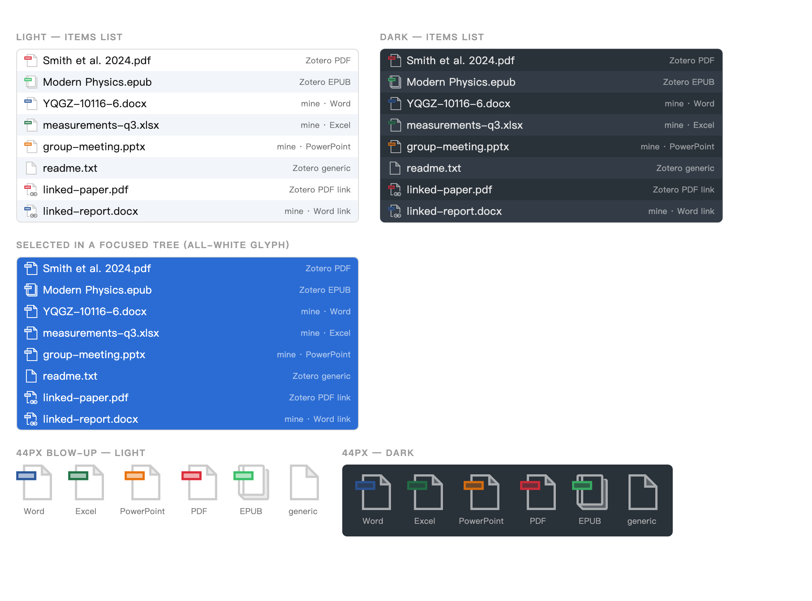

# Attachment Type Icons for Zotero

Word, Excel, PowerPoint, Markdown, XMind and HTML attachments get their own icons in the items list instead of
the generic blank page.



## The problem

Zotero picks an attachment's icon in `Zotero.Item.prototype.getItemTypeIconName()`
(`chrome/content/zotero/xpcom/data/item.js`). It recognises PDF, EPUB, image and video;
every other imported file falls through to `attachmentFile`, which
`scss/components/_item-tree.scss` maps to `document.svg` — the blank page.

So `.docx`, `.xlsx` and `.pptx` all look identical. Worse, Zotero also strips the
extension from the attachment title when there is no dedicated icon, so an item can end
up with neither an icon nor a suffix to identify it by.

Zotero's position has been that this isn't customisable without modifying the source
([forums #80229](https://forums.zotero.org/discussion/80229/)), and it was still being
raised against 9.0-beta
([forums #130596](https://forums.zotero.org/discussion/130596/keep-file-extension-in-attachment-title-when-there-is-no-dedicated-icon)).

## Install

```
./build.sh
```

Then in Zotero: **Tools → Plugins → gear icon → Install Plugin From File…** and pick
`attachment-type-icons-1.0.3.xpi`. No restart needed.

## What it covers

Icons appear everywhere Zotero resolves an icon through `getItemTypeIconName()`:

- the items list, first column
- attachment rows in the item pane's Attachments section (`elements/attachmentRow.js`)

Formats, by content type with a filename-extension fallback (for files stored with no
content type or a generic one, which is common with drag-and-drop and sync tools):

| Icon | Extensions |
|---|---|
| Word | `doc` `docx` `docm` `dot` `dotx` `dotm` `odt` `rtf` |
| Excel | `xls` `xlsx` `xlsm` `xlsb` `xlt` `xltx` `xltm` `ods` `csv` |
| PowerPoint | `ppt` `pptx` `pptm` `pps` `ppsx` `ppsm` `pot` `potx` `odp` |
| Markdown | `md` `markdown` `mdown` `mkd` `mkdn` `mdwn` `mdtxt` `mdtext` |
| XMind | `xmind` `xmt` |
| HTML | `html` `htm` |

Linked files get the chain-badge variant, matching how Zotero distinguishes
`attachment-pdf` from `attachment-pdf-link`.

## What it does not cover

- **The paperclip column** (the small 12px icon on the right of a parent item's row).
  That path is `renderHasAttachmentCell()` in `chrome/content/zotero/itemTreeRow.js`,
  which hardcodes its own type checks against `getBestAttachmentStateCached()` instead
  of going through `getItemTypeIconName()`. Covering it means patching attachment-state
  logic that sync also reads — deliberately left alone.
- **The attachment preview box** in the item pane, which is driven by a separate
  `data-preview-type` attribute (`scss/elements/_attachmentPreview.scss`).
- **Opening the files.** Double-click still hands them to the OS exactly as before;
  this plugin only touches icons.

## How it works

`bootstrap.js` wraps `getItemTypeIconName()` so Office, Markdown, XMind and HTML files return
`attachmentWord` / `attachmentExcel` / `attachmentPowerPoint` / `attachmentMarkdown` / `attachmentXMind` (plus `…Link` variants),
and injects `style.css`, which defines icons for those names. The wrapper falls back to
the original function on anything unexpected, and `shutdown()` restores it.

Unknown item-type names are safe elsewhere in Zotero: the deprecated
`Zotero.ItemTypes.getImageSrc()` falls through its switch to `document.svg` rather than
throwing.

**On the CSS specificity.** Zotero emits three tiers of rules for the default
(unrecognised) item type:

```
.icon-item-type                                                    (0,1,0)
.focus-states-target .row .icon-item-type                          (0,3,0)
.focus-states-target:focus-within .row.selected .icon-item-type    (0,5,0)
```

Our types are unrecognised, so those are what we're competing with. `style.css` mirrors
each tier with the `[data-item-type]` attribute added, landing one point ahead at every
tier — so the cascade resolves correctly without `!important`, including the all-white
glyph Zotero switches to for a selected row in a focused tree.

## Artwork

The icons are Zotero's own `attachment-pdf` geometry with the badge recoloured, so they
sit flush with the native PDF and EPUB icons in all three states (light, dark, and the
colourless selected variant, which is shared across all families — exactly as Zotero's
own PDF and EPUB icons become indistinguishable when selected).

To change colours or add a family, edit `FAMILIES` in `tools/gen-icons.py` and re-run
it; it regenerates `icons/` and `style.css` together. The detection tables live in
`bootstrap.js` and have to be updated to match.

PowerPoint deliberately uses orange (`#E8730C`) rather than its brand `#C43E1C`: the
brand colour shares the page geometry with PDF and reads as the same red at 16px. Excel
needs no such nudge — EPUB is also green, but its glyph is a book rather than a page.
Markdown has no brand colour of its own, so it uses purple (`#8250DF`), which clashes
with none of the other badges. XMind uses cyan (`#0891B2`) instead of its own red/orange,
which would be indistinguishable from PDF and PowerPoint.
HTML uses the web orange (`#E34F26`) and a small hand-drawn `</>` mark inside the
page body, so `.html` and `.htm` remain recognisable at Zotero's 16px icon size.

## Compatibility

`manifest.json` declares Zotero 7.0–11.\*. Verified against the Zotero source as of
10.0.2-beta. If the icons stop appearing after a major upgrade, the likely cause is
`getItemTypeIconName()` or the item-tree icon CSS having changed shape upstream — the
wrapper falls back to the original function, so the failure mode is "no icons", not a
broken list.

### Why `update_url` is there, and why it must be HTTPS

Zotero patches Firefox's manifest validation (`Extension.sys.mjs`, `parseManifest`) to
make **three** fields mandatory for any plugin:

```js
if (!manifest.applications?.zotero?.id)                  manifestError(...)
if (!manifest.applications?.zotero?.update_url)          manifestError(...)
if (!manifest.applications?.zotero?.strict_max_version)  manifestError(...)
```

A missing one fails the install with Zotero's generic *"it may not be compatible with
this version of Zotero"* dialog — the same message every install failure gets
(`standalone.addonInstallationFailed.body`), so it points at version numbers even when
they are fine.

Then, separately, the URL must be **HTTPS**. Firefox's `XPIDatabase.isUsableAddon()`
checks `providesUpdatesSecurely` whenever `extensions.checkUpdateSecurity` is on (it is),
and a plugin that fails it installs but comes up `appDisabled` — which the file-picker
flow also reports as an install failure. A `file://` URL passes the manifest check and
fails this one, which cost an afternoon.

The URL does not have to resolve: a failed update check is logged and retried, nothing
more. `updates.json` in this repo is the file it would fetch if you publish it at that
address.

Note that `strict_max_version` is only *enforced* on release builds: Zotero sets
`strictCompatibility = false` whenever the app version contains `-beta`, `-dev` or
`SOURCE` (`XPIInstall.sys.mjs`).
